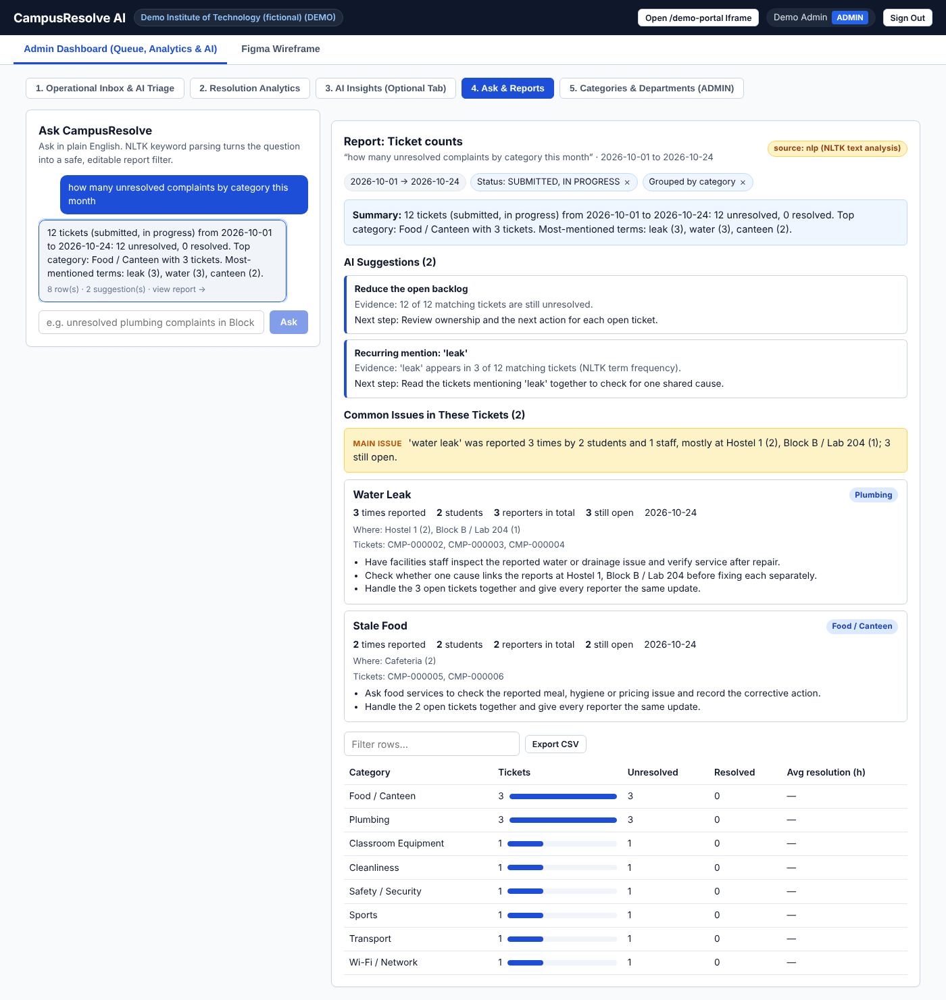
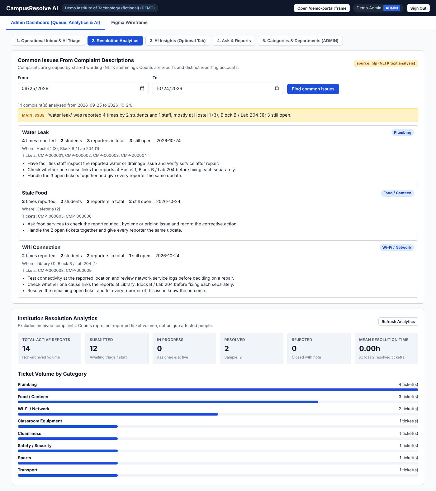
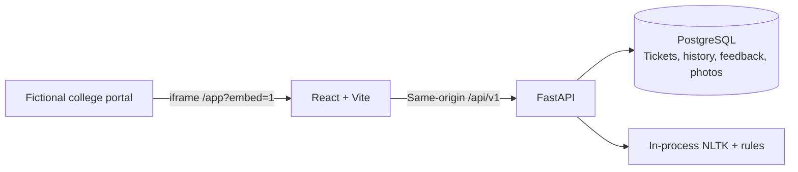

# CampusResolve AI

CampusResolve AI is a campus issue-reporting and resolution prototype built by **Rohan Sai, Atif, and Sonia** for **REVA Weekend Hackathon Problem Statement #3**. Students and staff report issues with optional photos, track tickets through departmental resolution, and give feedback. Administrators can measure resolution times and investigate recurring complaints through the same dashboard.

[Demo app](https://campusresolve-ai-sigma.vercel.app/app) · [Embedded portal](https://campusresolve-ai-sigma.vercel.app/demo-portal) · [Project progress](#project-progress) · [Local setup](#run-locally) · [License](#license)

## Try the demo

Open the [demo app](https://campusresolve-ai-sigma.vercel.app/app) or try the same workflow inside the [fictional college portal](https://campusresolve-ai-sigma.vercel.app/demo-portal). The public demo uses Vercel and Neon PostgreSQL. It runs on shared synthetic data, so use fictional reports and images.

| Role | Demo email |
| --- | --- |
| Student | `student@demo.edu` |
| Department staff | `it.staff@demo.edu` or `facilities.staff@demo.edu` |
| Coordinator | `coordinator@demo.edu` |
| Administrator | `admin@demo.edu` |

Every demo account uses password `demo1234`. The login screen offers quick-fill buttons. Additional student accounts run from `student2@demo.edu` through `student8@demo.edu`.

As a student, open **My Complaints** to see the reporting workflow. As an admin, open **Ask & Reports** and try “average resolution time by department.” The demo app, portal, admin reporting API, and student access restriction were checked on **21 November 2026**.

## What’s implemented

| Area | Capability |
| --- | --- |
| Reporting | Students and staff submit a description, campus location, optional category, and an optional JPEG or PNG. The app derives a unique `CMP-…` ticket number from the PostgreSQL ticket ID. Reporters can edit submitted tickets and retry failed uploads. |
| Routing and access | Configured categories route tickets to departments. Uncategorized tickets enter review. Admins and coordinators can assign a department and an eligible staff member. FastAPI enforces role, institution, and ticket access, including for images. |
| Resolution and feedback | Tickets progress through **Submitted → In Progress → Resolved**, with **Rejected** available from either open state. The UI asks staff to confirm verification before resolution. Resolved and rejected tickets require an outcome note. The original reporter can rate and comment on a resolved ticket. Assignment and status changes appear in the ticket history. |
| Administration | Administrators manage categories and departments and can archive tickets. The dashboard shows counts by status and category and mean time from creation to resolution. Archived tickets are excluded from analytics. |
| Assisted triage | NLTK suggests a category, priority, department, and next steps using the institution’s configured options. Authorized users review suggestions before applying changes. |
| Ask & Reports | English questions about ticket counts, lists, and mean resolution time produce report tables with editable filters, grouping, and CSV export. The backend converts questions into supported filter plans and uses parameterized queries. |
| AI Insights | Date-range reports highlight recurring issues, location hotspots, and high-priority open tickets. Recommendations cite the underlying counts. Common-issue groups use shared words and phrases and report distinct reporter accounts. |
| Embedded view | `/app?embed=1` provides a compact layout. The fictional `/demo-portal` embeds it and uses the same API and database. |

New installations seed **15 categories** and **8 departments**, covering areas such as IT, Facilities, Transport, Food Services, Hostel Office, and Campus Security.

## Screenshots

| Ask & Reports | Common issues |
| --- | --- |
|  |  |

[Student submission with a photo](frontend/screenshots/01_student_submitted_with_image.png) · [Ticket triage](frontend/screenshots/02_admin_ai_suggestions_no_mutation.png) · [Resolution and history](frontend/screenshots/04_staff_resolved_with_history.png) · [Reporter feedback](frontend/screenshots/05_student_feedback_submitted.png) · [Resolution analytics](frontend/screenshots/06_admin_resolution_analytics.png) · [AI Insights](frontend/screenshots/07_admin_ai_insights_and_report.png)

## Project progress

| Milestone | What shipped |
| --- | --- |
| v0.1.0 · 24 Oct 2026 | The team designed the ticket lifecycle, roles, and API. Rohan set up the repository and seed contract. |
| v0.2.0 · 24 Oct 2026 | Atif’s FastAPI/PostgreSQL backend, Rohan’s rules-based assistance, and Sonia’s React UI came together in the working prototype. The team verified the full ticket-to-feedback flow and shared the demo through a temporary Cloudflare tunnel. [PRs #1](https://github.com/Rohan-Ktksu/CampusResolve-AI/pull/1), [#2](https://github.com/Rohan-Ktksu/CampusResolve-AI/pull/2), [#3](https://github.com/Rohan-Ktksu/CampusResolve-AI/pull/3), [#4](https://github.com/Rohan-Ktksu/CampusResolve-AI/pull/4) |
| v0.3.0 · 24 Oct 2026 | Added in-process NLTK, Ask & Reports, common-issue grouping, eight categories, and three departments. API contract v0.3 added the reporting and common-issues endpoints. [PR #5](https://github.com/Rohan-Ktksu/CampusResolve-AI/pull/5) |
| v0.4.0 · 24 Oct 2026 | Moved the public demo to Vercel and Neon. New ticket photos moved into PostgreSQL, and schema setup was made safe across concurrent cold starts. [PRs #7](https://github.com/Rohan-Ktksu/CampusResolve-AI/pull/7), [#8](https://github.com/Rohan-Ktksu/CampusResolve-AI/pull/8), [#9](https://github.com/Rohan-Ktksu/CampusResolve-AI/pull/9) |
| v0.4.1 · 24 Oct 2026 | Added a starter dataset of 41 fictional complaints across 14 categories, six more student accounts, and more focused common-issue matching. [PR #10](https://github.com/Rohan-Ktksu/CampusResolve-AI/pull/10) |
| Repository updates · Oct–Nov 2026 | Cleaned up internal documentation and adopted GNU GPL v3.0 on 10 November. [PRs #11](https://github.com/Rohan-Ktksu/CampusResolve-AI/pull/11), [#12](https://github.com/Rohan-Ktksu/CampusResolve-AI/pull/12), [#13](https://github.com/Rohan-Ktksu/CampusResolve-AI/pull/13) |

The latest application milestone is **v0.4.1**. The active [OpenAPI contract](docs/openapi.json) is **v0.3.0** with **33 operations**. See the [changelog](CHANGELOG.md) and [frontend contract review](docs/coordination/frontend.md).

## Architecture



The public deployment serves the React build on Vercel, runs FastAPI through `api/index.py`, and stores application data on Neon. The Vercel function region is Singapore. New uploads are stored in PostgreSQL and served through authenticated ticket endpoints. The default upload limit is **5 MiB locally** and **4 MiB on the hosted demo**. See the [deployment config](vercel.json) and [API contract](docs/API_CONTRACT.md).

The assistant runs inside FastAPI and uses `source: nlp` for NLTK analysis and `source: rules` for fallback. It requires no model downloads, model API keys, or paid inference. See the [assistance implementation](backend/app/ai/README.md).

To reproduce the hosted demo, use the repository root as the Vercel project and provide a Neon PostgreSQL `DATABASE_URL`, a private `AUTH_SECRET`, and `MAX_UPLOAD_BYTES=4194304` in the deployment environment. The schema and demo accounts initialize on first use. Load the sample complaints separately with the seed script.

## Run locally

You’ll need Git, Python 3.12+, Node.js with npm, and PostgreSQL 14+.

1. Clone the repository and install dependencies from its root. These commands use PowerShell.

   ```powershell
   git clone https://github.com/Rohan-Ktksu/CampusResolve-AI.git
   cd CampusResolve-AI
   python -m venv .venv
   .\.venv\Scripts\python.exe -m pip install -r backend/requirements.txt
   npm --prefix frontend ci
   if (!(Test-Path .env)) { Copy-Item .env.example .env }
   ```

2. Create the local `campusresolve` PostgreSQL database and user. In the root `.env`, set `DATABASE_URL` to match your local PostgreSQL credentials and set `AUTH_SECRET` to a private random value. Database setup examples are in the [backend README](backend/README.md).

3. Start FastAPI from the repository root. The backend creates its schema and fictional demo accounts at startup.

   ```powershell
   .\.venv\Scripts\python.exe -m uvicorn app.main:app --app-dir backend --host 127.0.0.1 --port 8000
   ```

4. Start the frontend from the repository root in a second terminal.

   ```powershell
   npm --prefix frontend run dev -- --host 127.0.0.1 --strictPort
   ```

Open the [local app](http://127.0.0.1:5173/app), [local portal](http://127.0.0.1:5173/demo-portal), or [FastAPI docs](http://127.0.0.1:8000/docs). To populate the local dashboard with sample complaints, run `.\.venv\Scripts\python.exe scripts/seed_demo_data.py` while both servers are running.

### Verification

Run these checks from the repository root after installing dependencies.

```powershell
.\.venv\Scripts\python.exe scripts/check_contract.py
.\.venv\Scripts\python.exe -m unittest discover -s tests/ai
npm --prefix frontend run build
npm --prefix frontend test
```

For the [PostgreSQL integration suite](backend/README.md#3-test), use a disposable `campusresolve_test` database. The test fixture drops and recreates its public schema. The recorded v0.3 verification covered 33 API operations, 39 AI unit tests, 22 PostgreSQL integration tests, the frontend build, and browser workflows. See the [frontend verification](docs/coordination/frontend.md) and [AI test evidence](docs/coordination/ai.md).

## Team

| Contributor | Work |
| --- | --- |
| [Rohan Sai](https://github.com/Rohan-Ktksu) | Project lead, repository setup, ticket triage, Ask & Reports, common issues, integration, and deployment |
| [Atif](https://github.com/Atif-Ur-Rehman) | FastAPI, PostgreSQL, API contract, permissions, ticket lifecycle, analytics, and assistance route integration |
| [Sonia](https://github.com/sonia449-prog) | Figma wireframe, React screens, admin dashboard, embedded portal, contract review, and browser verification |

The team designed the system together. [Original REVA problem statements](reference/REVA_Problem_Statements_Source.docx) · [Frontend wireframe](frontend/FIGMA_WIREFRAME.md)

## Prototype scope

The demo has one fictional institution with seeded roles. Real campus integration, SSO, self-service enrollment, and production hardening remain outside the prototype. English report queries cover a fixed set of metrics and filters. Shared wording drives common-issue groups, so reports of the same issue can land in separate groups.

## License

CampusResolve AI is licensed under the [GNU General Public License v3.0](LICENSE).
