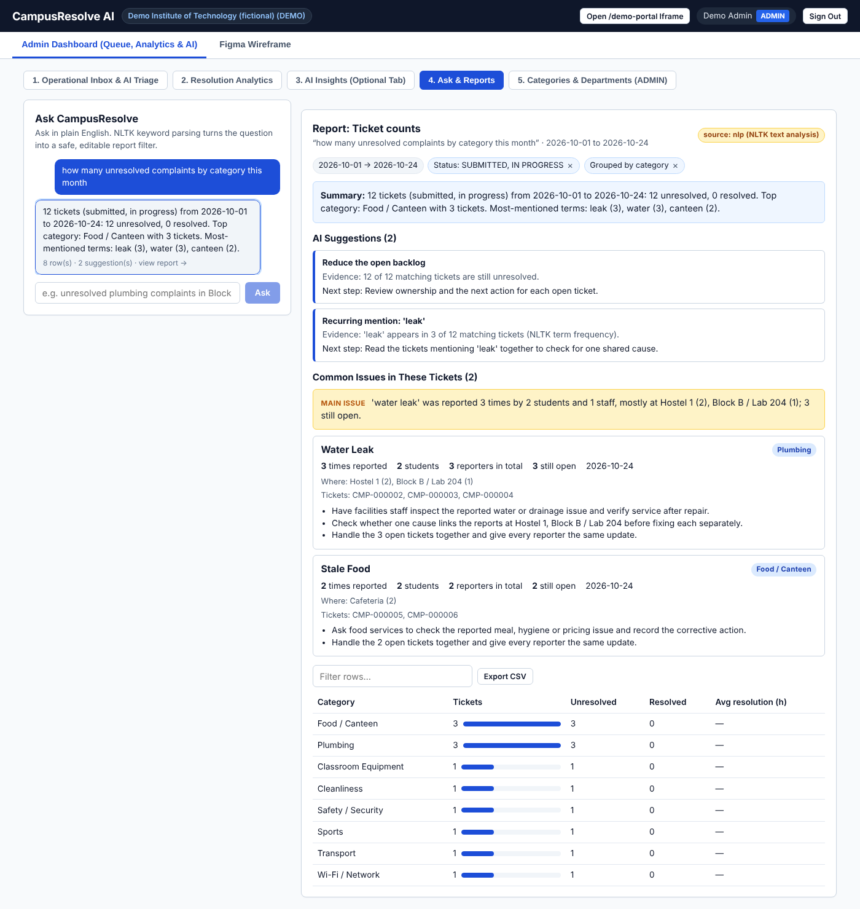
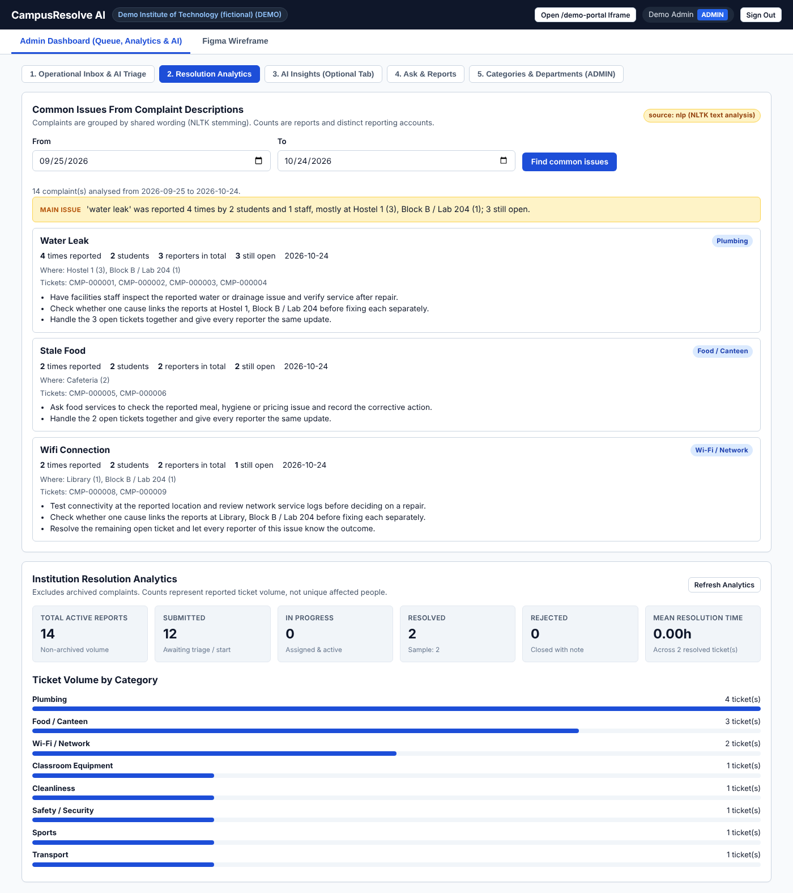
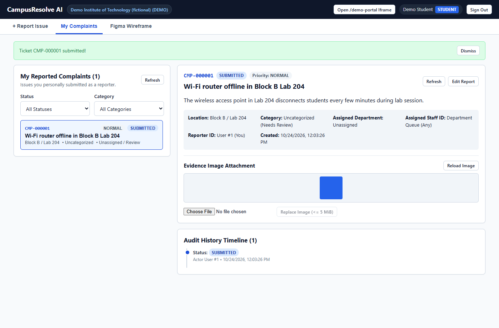
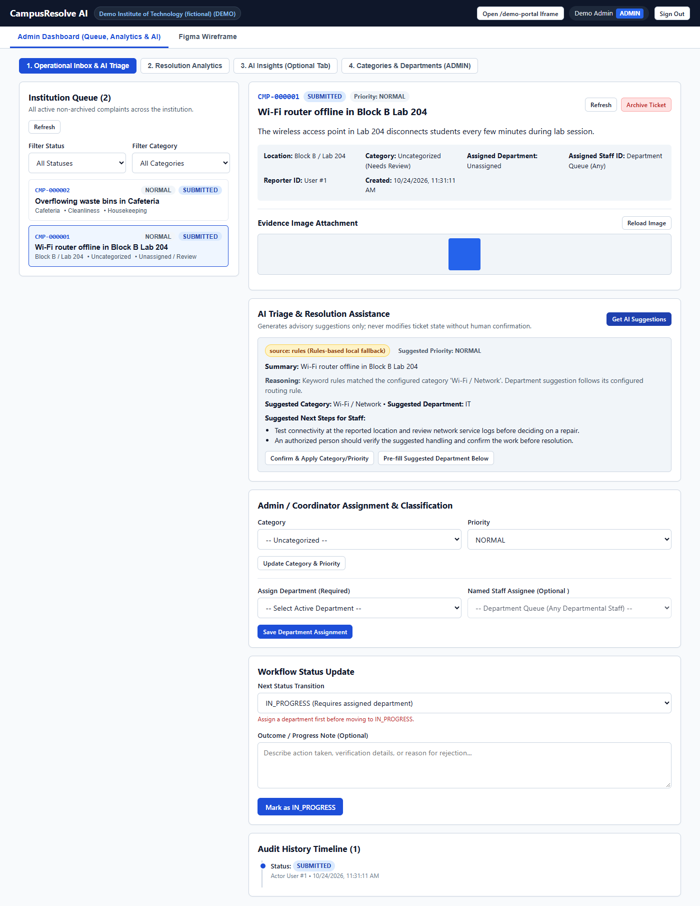
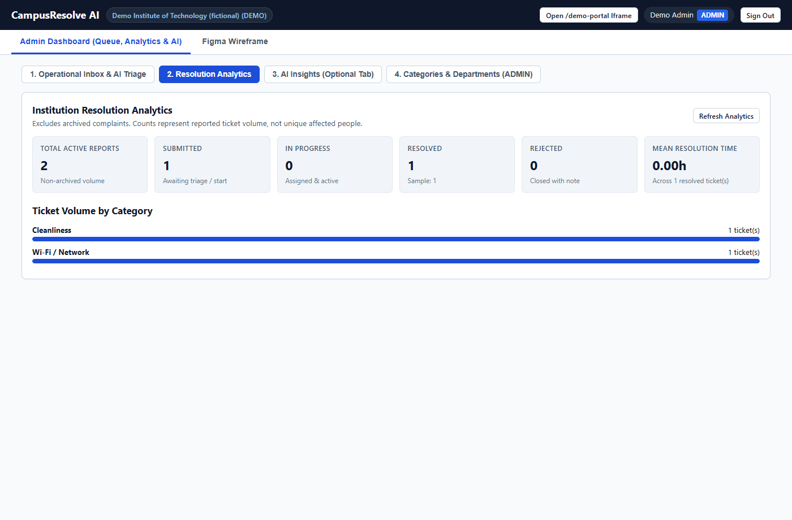
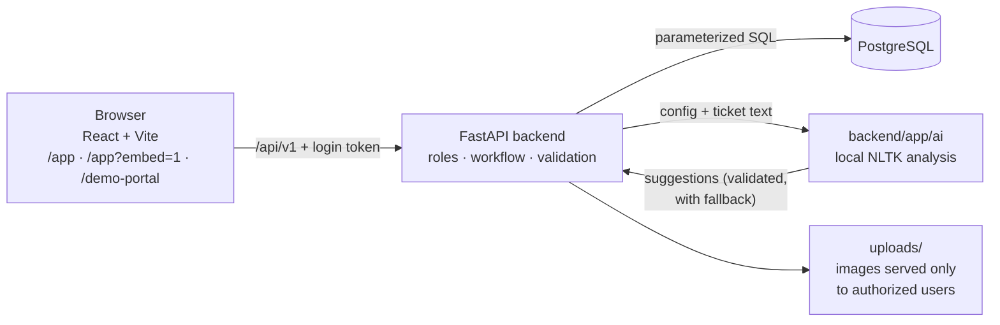

<div align="center">

# 🏫 CampusResolve AI

**Report a campus problem in seconds. Route it to the right team. Resolve it, measure it, learn from it.**


[**▶ Live demo**](#-live-demo) · [Versions](#-versions) · [Features](#-what-it-does) · [How it works](#-how-it-works) · [Journey](#-the-journey) · [Team](#-team--contributions) · [Run it locally](#-run-it-locally)

</div>

---

Built for **REVA Problem Statement #3** (campus issue reporting and resolution) by **Rohan Sai**, **Atif** and **Sonia**. Students and staff report problems with a description and optional photo and get a ticket number. Departments work through their queue, reporters rate the outcome, and admins see real resolution analytics. A local NLTK assistant suggests where each ticket should go, answers admins' questions in plain English and spots the issues that keep coming back.

> Working title: *CampusResolve AI*. *SunoSetu* has been suggested as a future name; no rename has been decided.

## ▶ Live demo

| | Link |
|---|---|
| App | https://campusresolve-ai-sigma.vercel.app/app |
| Fictional college portal (app embedded) | https://campusresolve-ai-sigma.vercel.app/demo-portal |

Log in with any [demo account](#-demo-accounts) (password `demo1234`). Please use made-up data only.

> **Always on.** Hosted free on Vercel with a Neon PostgreSQL database (both in Singapore). It updates automatically whenever `main` changes; see [Deploy](#-deploy-free-vercel--neon). The first request after a quiet spell can take a few seconds while the server wakes up.

## ✨ What it does

**For students and staff**
- 📝 Report an issue with a title, description, location, category and an optional JPEG/PNG photo (checked server-side, max 5 MB).
- 🎫 Get a unique ticket number such as `CMP-000042` and follow its status and history.
- ⭐ Rate the resolution and leave feedback once the ticket is closed.

**For department staff**
- 📥 A queue of their department's tickets.
- 🔄 Move tickets through **Submitted → In Progress → Resolved / Rejected**, with a required outcome note when closing.

**For admins and coordinators**
- 🧭 **AI triage:** suggests a category, department, priority and next steps for each ticket. Suggestions never change the ticket; a person confirms them.
- 📊 **Resolution analytics:** ticket counts by status and category, and mean resolution time computed from real timestamps.
- 💬 **Ask & Reports (chatbox):** ask in plain English, e.g. *"unresolved food complaints in Hostel 1 last month"* or *"average resolution time by department"*. You get a sortable, filterable table with CSV export, a summary, evidence-based suggestions and the common issues among the matching tickets. Each filter appears as a chip you can remove to re-run the report.
- 🔍 **Common issues:** complaint descriptions are grouped by shared wording, so you can see *what* keeps happening, *how many times* it was reported, *how many students* reported it, where, and what to do next.
- 📑 **AI Insights report:** an on-demand report for any date range, with recommendations that cite the actual counts.
- ⚙️ **Configuration:** manage departments and categories. 15 categories are seeded, including Wi-Fi, Plumbing, Electrical, Infrastructure, Food / Canteen, Hostel, Safety / Security, Housekeeping, Library, Academics, Sports and Transport.

**Embeddable:** `/app?embed=1` is a compact view of the same app, and `/demo-portal` shows it inside a fictional college portal, sharing the same login, API and database.

## 📸 Screenshots

| Ask & Reports chatbox | Common issues on the dashboard |
|---|---|
|  |  |

| Student report with photo | AI triage (suggestions only) | Resolution analytics |
|---|---|---|
|  |  |  |

More: [assignment](frontend/screenshots/03_admin_assigned_it_staff.png) · [resolved with history](frontend/screenshots/04_staff_resolved_with_history.png) · [feedback](frontend/screenshots/05_student_feedback_submitted.png) · [AI Insights](frontend/screenshots/07_admin_ai_insights_and_report.png) · [report with common issues](docs/screenshots/10_admin_report_with_common_issues.png). All screenshots use synthetic data.

## 🧠 How it works



- **One backend, one database.** The AI code runs inside the backend; there is no separate AI server and no external API call.
- **Permissions on the server.** Every request re-checks the user's role and institution. Students see their own tickets, staff see their department's queue, admins and coordinators see everything.
- **AI that can't break the workflow.** Every AI result is validated against the API models and the institution's real category/department IDs. If anything fails, the route returns a clearly labelled fallback (`source: rules`) instead of an error.

**How the chatbox answers a question**

```
"how many food complaints in Hostel 1 were unresolved last month?"
  → NLTK parsing: dates · named departments · locations · categories (stemming + typo tolerance)
                  · status · priority · grouping · metric
  → allow-listed plan { count · Food / Canteen · Hostel 1 · open · 1–30 Sep }   (text never becomes SQL)
  → parameterized queries → table + totals + matching tickets
  → summary + up to 4 evidence-based suggestions + common issues → report panel
```

**How common issues are found:** each ticket's words are stemmed with NLTK ("leaking" → "leak"), filler words and location names are dropped, and the word or two-word phrase shared by the most tickets becomes an issue. Those tickets are set aside and the search repeats. Each issue reports times reported, distinct student and staff reporters, how many are still open, where, and suggested next steps. Complaint text is analysed but never quoted.

NLTK pieces used: `SnowballStemmer`, `RegexpTokenizer`, `edit_distance` and `ngrams`. All of them work after `pip install`, with no `nltk.download`. Details: [docs/AI_CONTRACT.md](docs/AI_CONTRACT.md) · [backend/app/ai/README.md](backend/app/ai/README.md).

## 🛤 The journey

The whole build happened on **24 October 2026**, by three people working in parallel, each with their own coding assistant, coordinating only through Git.

1. **Plan and handoff (Rohan).** Turned REVA Problem #3 into a [master plan](docs/PROJECT_MASTER_PLAN.md) with P0 must-haves first. Set up the repo, ownership rules ([AGENTS.md](AGENTS.md)) and a seed API contract.
2. **Agree the API without meetings (Atif → Sonia).** Atif proposed contract **v0.2** and published its SHA-256. Sonia reviewed it from Git and recorded `ACCEPTED` with the same hash. The contract was frozen before anyone built against it ([how it works](docs/coordination/README.md)).
3. **Build in parallel.**
   - **Backend (Atif):** FastAPI + PostgreSQL with all 31 operations: auth, complaints, images, assignment, status workflow with history, feedback and analytics.
   - **Frontend (Sonia):** React screens for every role, the admin dashboard, the embedded view and the portal.
   - **AI (Rohan):** local ticket suggestions and evidence-backed admin reports, plugged into Atif's routes with a validated fallback.
4. **Integrate and prove it.** A real frontend request created a PostgreSQL ticket. Sonia ran the full flow (submit → assign → resolve → feedback → analytics) on Windows and captured screenshots. Atif verified the AI functions on the live endpoints. PRs #1, #2 and #3 were merged.
5. **Go live.** Atif rewrote the README and published the temporary Cloudflare link (PR #4).
6. **Make the AI genuinely useful (v0.3).**
   - Moved from exact keyword matching to NLTK.
   - Added the **Ask & Reports chatbox**, **common issues** and 8 more categories (PR #5).
   - Sonia accepted contract v0.3 with a matching hash and verified it through the live link.
7. **Lock it down.** `main` is now protected: pull requests with one approval, no force-pushes, no deletion.

**Rules we kept throughout:** no paid APIs, hosting or CI; synthetic data only; nothing presented as a trained model; every test result recorded honestly in [`docs/coordination/`](docs/coordination/).

## 🗂 Versions

Every release and update, newest first. Full details in [CHANGELOG.md](CHANGELOG.md).

| Version | Date | What changed | PRs | API contract | Runs on |
|---|---|---|---|---|---|
| **v0.4.1** | 2026-10-24 | 41 synthetic demo complaints across 14 categories (resolved, in progress, rejected, with feedback); 6 more demo student accounts; common issues ignore state words like "not" or "broken" | this update | v0.3 (unchanged) | Vercel + Neon |
| **v0.4.0** | 2026-10-24 | Free always-on hosting on Vercel + Neon (Singapore); photos stored in PostgreSQL; safe concurrent start-up; CHANGELOG | [#7](https://github.com/Rohan-Ktksu/CampusResolve-AI/pull/7), [#8](https://github.com/Rohan-Ktksu/CampusResolve-AI/pull/8), [#9](https://github.com/Rohan-Ktksu/CampusResolve-AI/pull/9) | v0.3 (unchanged) | Vercel + Neon |
| **v0.3.0** | 2026-10-24 | NLTK assistant; Ask & Reports chatbox; common issues; 8 new categories and 3 departments; README rewrite; `main` protected | [#5](https://github.com/Rohan-Ktksu/CampusResolve-AI/pull/5) | v0.3 `d726d73c…` (additive) | Cloudflare tunnel |
| **v0.2.0** | 2026-10-24 | Working prototype: FastAPI + PostgreSQL backend, React frontend, rules-based AI, live demo | [#1](https://github.com/Rohan-Ktksu/CampusResolve-AI/pull/1)–[#4](https://github.com/Rohan-Ktksu/CampusResolve-AI/pull/4) | v0.2 `d32af66a…` (frozen) | Cloudflare tunnel |
| **v0.1.0** | 2026-10-24 | Team handoff: master plan, ownership rules, seed API and AI contracts | — | v0.1 seed | — |

## 👥 Team & contributions

| | Role | Owned area | Highlights |
|---|---|---|---|
| **Rohan Sai** ([@Rohan-Ktksu](https://github.com/Rohan-Ktksu)) | Project lead, AI | `backend/app/ai/`, `tests/ai/`, setup & integration | Master plan and team rules; AI ticket triage and reports; v0.3 NLTK chatbox and common issues; free Vercel + Neon deployment; reviews and merges |
| **Atif** ([@Atif-Ur-Rehman](https://github.com/Atif-Ur-Rehman)) | Backend | `backend/` (except `ai/`), API contract | Contract v0.2; FastAPI + PostgreSQL API (31 operations, 17 tests); AI route wiring and fallbacks; README and live demo link |
| **Sonia** ([@sonia449-prog](https://github.com/sonia449-prog)) | Frontend | `frontend/` | Contract reviews (v0.2, v0.3); Figma wireframe; React UI for all roles; Windows end-to-end verification; hosts the live demo |

| PR | What | By |
|---|---|---|
| [#1](https://github.com/Rohan-Ktksu/CampusResolve-AI/pull/1) | Backend: FastAPI + PostgreSQL complaint lifecycle (contract v0.2) | Atif |
| [#2](https://github.com/Rohan-Ktksu/CampusResolve-AI/pull/2) | AI assistance: ticket recommendations and admin reports | Rohan |
| [#3](https://github.com/Rohan-Ktksu/CampusResolve-AI/pull/3) | Frontend: React workflow, admin dashboard, E2E verification | Sonia |
| [#4](https://github.com/Rohan-Ktksu/CampusResolve-AI/pull/4) | README for the working prototype + live demo link | Atif |
| [#5](https://github.com/Rohan-Ktksu/CampusResolve-AI/pull/5) | Admin chatbox, common issues, NLTK analysis (contract v0.3) | Rohan |
| [#7](https://github.com/Rohan-Ktksu/CampusResolve-AI/pull/7), [#8](https://github.com/Rohan-Ktksu/CampusResolve-AI/pull/8), [#9](https://github.com/Rohan-Ktksu/CampusResolve-AI/pull/9) | Free Vercel + Neon deployment, CHANGELOG, permanent live link | Rohan |

Each person's commands, results and known gaps are in [`docs/coordination/`](docs/coordination/) ([backend](docs/coordination/backend.md) · [frontend](docs/coordination/frontend.md) · [AI](docs/coordination/ai.md)).

## 🚀 Run it locally

Requires Python 3.12+, Node.js/npm and PostgreSQL 14+. Everything is free and local.

1. **Database.** Create user `campusresolve` with databases `campusresolve` and `campusresolve_test`. Exact Windows (`psql`) and podman/docker commands are in [backend/README.md](backend/README.md).
2. **Config.** Copy `.env.example` to `.env` and set `DATABASE_URL` and a random `AUTH_SECRET`. Never commit `.env`.
3. **Backend** (http://127.0.0.1:8000, API docs at `/docs`). Tables and demo data are created on first start:

   ```powershell
   python -m venv .venv
   .\.venv\Scripts\Activate.ps1          # Linux/macOS: source .venv/bin/activate
   pip install -r backend/requirements.txt
   cd backend
   uvicorn app.main:app --port 8000
   ```

4. **Frontend** (http://127.0.0.1:5173; the dev server forwards `/api` to the backend):

   ```powershell
   cd frontend
   npm install
   npm run dev
   ```

   Then open `/app`, the embedded view `/app?embed=1`, or the portal `/demo-portal`.

## ☁️ Deploy (free: Vercel + Neon)

The repo deploys as one Vercel project: the React app as static files and the FastAPI backend as a Python function (`api/index.py`), with PostgreSQL on Neon. Photos are stored in the database because serverless functions keep no files.

1. Create a free Neon project (Singapore region) and copy its connection string.
2. Import the GitHub repo into Vercel. `vercel.json` sets the build, the `/api/*` routing and the Singapore region.
3. In Vercel → Project → Settings → Environment Variables add `DATABASE_URL` (Neon connection string), `AUTH_SECRET` (long random string) and `MAX_UPLOAD_BYTES=4194304` (Vercel's request limit is 4.5 MB).
4. Deploy. Tables and demo accounts are created on the first request. Every merge to `main` redeploys automatically.

## 🔑 Demo accounts

Fictional institution `DEMO`. Password `demo1234` for every account (local prototype only).

| Email | Role |
|---|---|
| student@demo.edu, student2@demo.edu, student3@demo.edu … student8@demo.edu | Student |
| it.staff@demo.edu | Staff, IT |
| facilities.staff@demo.edu | Staff, Facilities |
| coordinator@demo.edu | Coordinator |
| admin@demo.edu | Admin |

**Departments:** IT, Facilities, Housekeeping, Academics, Transport, Food Services, Hostel Office, Campus Security.

**Categories:** Wi-Fi / Network, Classroom Equipment, Electrical, Plumbing, Cleanliness, Transport, Infrastructure, Food / Canteen, Hostel, Safety / Security, Housekeeping, Library, Academics, Sports, Other.

Each category routes to its department; uncategorized tickets go to admin review.

## 🧪 Tests

```powershell
python scripts/check_contract.py                 # API contract sanity check
python -m unittest discover -s tests/ai          # NLTK triage, chatbox parser, common issues
cd backend; python -m pytest -q                  # API + AI integration on campusresolve_test (wiped each run)
cd frontend; npm run build; node test_frontend_contract.mjs
```

## 📚 Documents

- [docs/PROJECT_MASTER_PLAN.md](docs/PROJECT_MASTER_PLAN.md): product scope and priorities.
- [docs/API_CONTRACT.md](docs/API_CONTRACT.md) + [docs/openapi.json](docs/openapi.json): the API contract.
  - **v0.2:** frozen and accepted by backend and frontend.
  - **v0.3:** additive. Accepted by frontend (SHA-256 `d726d73c…`); backend review pending.
- [docs/AI_CONTRACT.md](docs/AI_CONTRACT.md): AI function interfaces, validation and fallbacks.
- [docs/coordination/README.md](docs/coordination/README.md): how contract changes are proposed and accepted through Git.
- [CHANGELOG.md](CHANGELOG.md): every version, what changed and where it runs.
- [AGENTS.md](AGENTS.md): ownership, branches and rules for every contributor and coding assistant.
- [docs/WINDOWS_SETUP.md](docs/WINDOWS_SETUP.md): Windows setup for teammates.

## 💸 No-spend promise

No paid inference, CI or subscription is needed. Everything runs on a laptop with PostgreSQL, and the public demo uses only free plans (Vercel Hobby + Neon Free, no card). AI output is labelled `source: nlp` (NLTK keyword analysis) or `source: rules` (fallback). Nothing is presented as a trained model.

## ⚠️ Limitations

- **Prototype only:** one fictional institution, seeded logins, no SSO or self-registration. Not production-hardened; tokens live in browser sessionStorage.
- **Chatbox scope:** it understands English questions about counts, lists, resolution time, grouping, filters and dates. Anything else falls back to overall totals with a warning.
- **Common issues match words, not meaning:** two reports of one problem worded differently can appear as separate issues. Reporter counts are distinct accounts, not verified people.
- **No real college integration:** no official college affiliation or ERP/SSO integration is claimed.

## 🙏 Attribution

Repository ownership and baseline setup belong to Rohan's verified Git identity. Atif and Sonia keep authorship of their work. The source brief is in [`reference/`](reference/).
